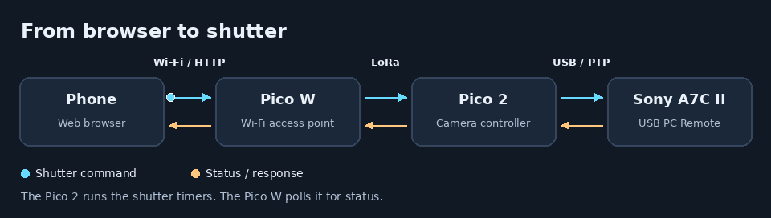
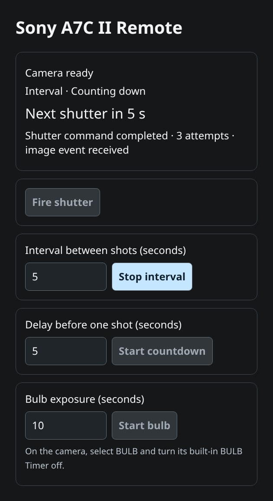
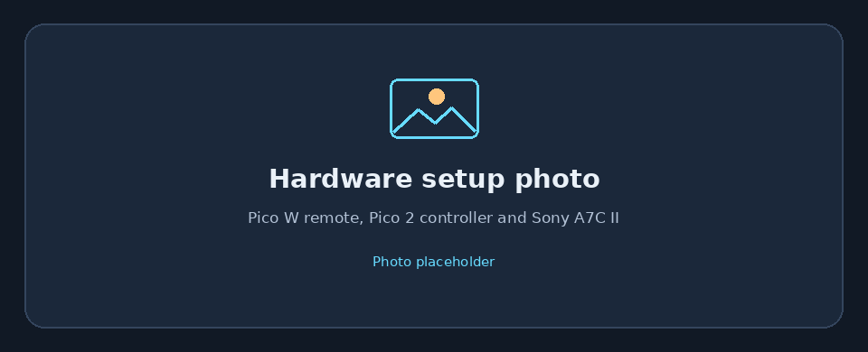

# Sony A7C II LoRa Shutter Remote

A two-board camera remote for field use. A phone connects to a Raspberry Pi Pico W over Wi-Fi and opens a local control page. The Pico W sends shutter commands over LoRa to a Raspberry Pi Pico 2 at the camera. The Pico 2 triggers a Sony A7C II over USB in PC Remote mode.



[Static diagram](docs/assets/communication.png)

| Link | Transport | What it carries |
| --- | --- | --- |
| Phone ↔ Pico W | Local Wi-Fi, DHCP, and HTTP | The control page, shutter requests, and cached camera status. Internet access is unnecessary. |
| Pico W ↔ Pico 2 | Point-to-point LoRa via two SPI-connected SX1278 radios | Commands and status queries outbound. Acknowledgements, camera state, and radio measurements inbound. |
| Pico 2 ↔ A7C II | PIO USB host and Sony's PTP extensions | Session setup, button press and release operations, PTP responses, and camera events. |
| Pico 2 ↔ computer | Built-in USB port, CDC serial | Optional diagnostics for radio reception, enumeration, and the PTP session. |

The Pico 2 runs all shutter timers. Once it accepts a command, a delayed shot, interval run, or bulb exposure can continue through a browser closure or LoRa outage. A stop command still needs the radio link.

## Control page



*The firmware page is rendered with sample camera status for this preview.*

| Control | Behavior |
| --- | --- |
| **Fire shutter** | Triggers one normal shutter sequence as soon as the Pico 2 accepts it. |
| **Start interval / Stop interval** | Fires immediately, then repeats at the chosen start-to-start interval. If one shutter sequence overruns its slot, the next starts when the camera controller is free. Stop allows the current sequence to finish. |
| **Start countdown** | Waits the specified number of seconds and fires once. |
| **Start bulb** | Sends the Sony bulb-start command, counts down from its acknowledgement, and releases the shutter when the timer expires. |

Timed controls accept whole seconds from 1 to 65,535. The page shows the latest operation result, attempt count, and whether an image event was observed. HTTP acceptance, a LoRa acknowledgement, and a completed USB shutter operation are three distinct stages.

## Hardware setup



<!-- Add your photo at docs/assets/setup-photo.jpg and change the image link and alt text above. -->

- One Raspberry Pi Pico W, one Raspberry Pi Pico 2, and two SX1278 LoRa modules with antennas matched to the radio band.
- A PIO USB host adapter for the Pico 2, a USB data cable to the camera's USB-C port, and power for both boards. The tested host uses **GP0 for D+** and **GP1 for D−**. The Pico 2's built-in USB port serves the serial console.
- A Sony A7C II (ILCE-7CM2) in **Remote Shoot (PC Remote)** mode. To save to the camera, insert a memory card and select a still-image destination that includes the camera. Use Single Shooting drive mode for one image per normal trigger. [Sony PC Remote help](https://helpguide.sony.net/ilc/2360/v1/en/contents/0903_pc_remote_function.html)

Wire each LoRa module the same way. Provide 3.3 V and a common ground.

| Module | Pico GPIO | Physical header pin |
| --- | --- | --- |
| MISO | GP16 | 21 |
| NSS / CS | GP17 | 22 |
| SCK | GP18 | 24 |
| MOSI | GP19 | 25 |
| RESET | GP20 | 26 |
| DIO0 | GP21 | 27 |

Both builds default to 433.5 MHz, BW 125 kHz, SF7, CR 4/5, and +7 dBm conducted transmit power. Keep both copies of `lora_config.h` in sync and use settings appropriate to your location and hardware.

## Flash and run

1. Enter BOOTSEL on each board and copy its matching UF2 to the mounted drive. Use both builds from this repository so the LoRa frame versions match.
   - [Pico W UF2](remote_pico_w/firmware/remote_pico_w.uf2)
   - [Pico 2 UF2](camera_pico2/firmware/camera_pico2.uf2)
2. Connect the camera to the Pico 2's PIO USB host adapter and select **Remote Shoot (PC Remote)** on the camera.
3. Join **KD_PICO_W** on the phone, open [http://192.168.4.1/](http://192.168.4.1/), and wait for **Camera ready**.
4. Fire a single shot and confirm that the image is saved. Then test interval start/stop and a delayed shot. For bulb testing, select Still → M → **BULB**, use the mechanical shutter, turn Silent Mode and the built-in BULB Timer off, and try a short exposure. Return to a normal shutter speed for the other controls. [Sony bulb shooting](https://helpguide.sony.net/ilc/2360/v1/en/contents/0302C_bulb.html) · [Sony BULB Timer](https://helpguide.sony.net/ilc/2360/v1/en/contents/211h_bulb_timer.html)

The Wi-Fi AP is open by default. Set `AP_PASSWORD` in [app_config.h](remote_pico_w/app_config.h) and rebuild to use WPA2. The web API and LoRa frames have no separate authentication. When testing a bulb exposure, keep the camera's USB link connected so the release command can reach it.

## Build from source

Use CMake, an Arm GNU toolchain, and Pico SDK 2.3.1 with its submodules. The camera build also needs Pico-PIO-USB. The bundled camera UF2 was built with Pico-PIO-USB commit `b186e36`.

```sh
cmake -S remote_pico_w -B build/remote -DPICO_SDK_PATH=/path/to/pico-sdk
cmake --build build/remote --parallel

cmake -S camera_pico2 -B build/camera -DPICO_SDK_PATH=/path/to/pico-sdk \
  -DPICO_PIO_USB_PATH=/path/to/Pico-PIO-USB
cmake --build build/camera --parallel
```

The build outputs are `build/remote/remote_pico_w.uf2` and `build/camera/camera_pico2.uf2`.

## From a Wireshark capture to the remote

The USB work started with a successful shutter trigger from a Linux PC. Wireshark captured traffic through Linux's `usbmon`, beginning at cable connection and continuing through a shutter trigger. The capture gave us the order of the PTP commands and their data and response phases. It showed the Sony session handshake, the half-press and full-press properties, the repeated property reads during the hold, and the two release operations.

For a repeat capture, load the Linux `usbmon` module, identify the camera's USB bus, and start on its `usbmonN` interface before connecting. Record one known-good shot and compare the PTP command, data, and response containers by transaction ID. The repository includes the implemented sequence and its opcode notes. The original capture is a separate project artifact.

The Pico 2 implementation first reproduced this sequence as a standalone shutter test. The LoRa link and Pico W control page were developed and tested independently, then connected to the USB implementation. The integrated firmware keeps the successful Sony session open between shots and uses libgphoto2's Sony bulb sequence for timed exposures. [Wireshark USB capture guide](https://wiki.wireshark.org/CaptureSetup/USB) · [Capture-derived implementation](camera_pico2/sony_ptp.c) · [libgphoto2 Sony controls](https://github.com/gphoto/libgphoto2/blob/662abd148dfd6ecbbacb3ddaa9134d4b357f15e1/camlibs/ptp2/config.c#L10622)

## Camera compatibility

The Sony A7C II in USB PC Remote mode is the hardware validated for this project. A camera that enumerates as a USB Still Image device can still require different commands to open a remote session, trigger a shot, or handle bulb. The code uses Sony-specific `0x92xx` operations and `0xD2xx` control properties.

Other Sony models need separate testing, including PC Remote session setup and bulb behavior. Canon, Nikon, Fujifilm, and other brands are unsupported by this firmware. A port can reuse the Wi-Fi UI, LoRa framing, and shot scheduler. Start by capturing or tracing a successful tethered shot for the target model, then implement its session, shutter, bulb, and event handling. A model that exposes a different USB interface may also require changes to the host transport.

## Code documentation

- [Pico W firmware](docs/pico-w.md) — AP and DHCP, raw lwIP server, HTTP API, browser logic, and RF polling.
- [Pico 2 firmware](docs/pico-2.md) — core ownership, shared state, scheduling, TinyUSB endpoints, and Sony transactions.
- [LoRa protocol](docs/lora-protocol.md) — register-level radio path, framing, payload layouts, retry behavior, and airtime accounting.

The firmware sources live in [remote_pico_w/](remote_pico_w/) and [camera_pico2/](camera_pico2/). Each directory is an independent CMake project.

## License

The original project code, documentation, and graphics are licensed under the GNU General Public License, version 3 only (`GPL-3.0-only`). See [LICENSE](LICENSE) for the full terms.

The MicroPython DHCP server files ([source](remote_pico_w/dhcpserver.c) and [header](remote_pico_w/dhcpserver.h)) retain their MIT license. The Raspberry Pi Pico SDK import scripts ([Pico W](remote_pico_w/pico_sdk_import.cmake) and [Pico 2](camera_pico2/pico_sdk_import.cmake)) retain their BSD 3-Clause notices. External build dependencies retain their upstream licenses.

## AI assistance

ChatGPT and Claude were used extensively in creating the software. The firmware was tested on the physical Pico boards with the Sony A7C II.
