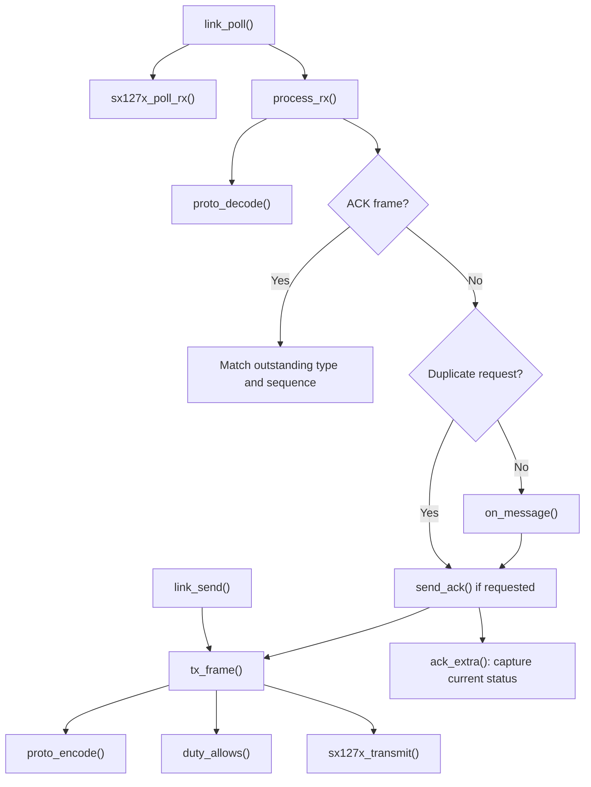

# LoRa radio and wire protocol

[Project README](../README.md) · [Pico W firmware](pico-w.md) · [Pico 2 firmware](pico-2.md)

The boards use point-to-point LoRa with a small binary application protocol. The shared source files are present in both build directories. Compare both copies when changing radio configuration or serialization.

## Driver and link layer

| Module | Responsibility |
| --- | --- |
| [lora_config.h](../remote_pico_w/lora_config.h) | SPI/GPIO assignments, modem parameters, transmit power, network identifier, and airtime budget. |
| [lora_setup.c](../remote_pico_w/lora_setup.c) | Translates configuration into driver settings, initializes the radio, then registers the link-layer hooks. |
| [sx127x.c](../remote_pico_w/sx127x.c) | Register I/O, FIFO transfers, receive polling, airtime estimation, and RSSI/SNR extraction. |
| [lora_proto.c](../remote_pico_w/lora_proto.c) | Frame serialization, header validation, and application CRC. |
| [lora_link.c](../remote_pico_w/lora_link.c) | Acknowledgements, duplicate detection, retries, receive dispatch, and airtime accounting. |
| [camera_wire.h](../remote_pico_w/camera_wire.h) | Camera action validation and explicit little-endian status encoding. |

`sx127x_init()` resets the radio, checks `RegVersion == 0x12`, switches from FSK sleep to LoRa mode, then programs frequency, modem, PA, FIFO, and interrupt registers. SPI runs at 1 MHz in mode 0. The radio uses explicit headers and its own payload CRC. The firmware polls IRQ status registers over SPI. DIO0 is configured and can be read for diagnostics.

`sx127x_transmit()` moves to standby, writes the frame to the FIFO, switches to transmit, polls `TxDone`, then restores continuous RX even after a TX timeout. `sx127x_poll_rx()` checks `RxDone`, rejects modem CRC failures and oversized packets, and reads the FIFO and RF measurements. The SX127x alternates between TX and RX.

## Frame format, version 2

Offsets are zero-based. Multibyte fields are little-endian.

| Offset | Size | Field |
| ---: | ---: | --- |
| 0 | 1 | Magic `0xCA`. |
| 1 | 1 | Network ID, default `0x42`. |
| 2 | 1 | Version in bits 7–4, flags in bits 3–0. Bit 0 requests an ACK. Bit 1 identifies an ACK. |
| 3 | 1 | Message type, echoed by an ACK. |
| 4 | 1 | Sequence number, echoed by an ACK. |
| 5 | 1 | Payload length `N`, maximum 48 bytes. |
| 6 | N | Payload. |
| 6 + N | 2 | CRC-16/CCITT-FALSE over the header and payload, with polynomial `0x1021` and initial value `0xFFFF`. |

The protocol frame and its checksum sit inside the radio's LoRa payload. The network ID and checksums filter packets and catch corruption. They provide no sender authentication or encryption.

### Request payloads

| Type | Length | Payload |
| --- | ---: | --- |
| `MSG_SHUTTER` (`0x04`) | 3 | `action:u8`, followed by `seconds:u16`. |
| `MSG_CAMERA_STATUS` (`0x05`) | 0 | Requests the current camera snapshot without scheduling a shot. |

| Action | Value | Seconds |
| --- | ---: | --- |
| `CAM_FIRE` | 1 | 0 |
| `CAM_INTERVAL` | 2 | 1–65,535 |
| `CAM_DELAY` | 3 | 1–65,535 |
| `CAM_BULB` | 4 | 1–65,535 |
| `CAM_STOP_INTERVAL` | 5 | 0 |

The older test message constants are still defined. The integrated camera handler accepts shutter and status requests.

### ACK payload

The standard four-byte prefix is `status:u8`, `RSSI:i16` in dBm, then `SNR:i8` in quarter-dB units. These RF measurements describe how the receiver heard the request. ACK status values are 0 accepted, 1 unknown type, 2 invalid payload, 3 busy, and 4 camera unavailable.

Both camera message types append the following 18-byte snapshot. Its offsets are relative to the start of the snapshot. The complete camera ACK is 30 bytes including the frame header and CRC.

| Offset | Size | Field |
| ---: | ---: | --- |
| 0 | 1 | `mode`, the active or latest run's action. 0 is idle before any operation. |
| 1 | 1 | `phase`. |
| 2 | 1 | `result`. |
| 3 | 1 | `ready`, a usable Sony session. |
| 4 | 4 | `remaining_ms`, until the next shot or bulb release in timed phases. |
| 8 | 4 | `shots`, completed attempts in this run. |
| 12 | 4 | `image_events`, count observed during the latest attempt. |
| 16 | 2 | `ptp_rc`, latest reported PTP response code. |

| Code | Phase | Result |
| ---: | --- | --- |
| 0 | Inactive | No result yet |
| 1 | Queued | Shutter sequence complete |
| 2 | Countdown | Interval stopped |
| 3 | Shooting | USB/PTP error |
| 4 | Bulb exposing | USB disconnected |
| 5 | Bulb releasing | Bulb release unconfirmed |
| 6 | Stopping after current shot | — |

An ACK with status 0 confirms that the Pico 2 accepted the command. Use the snapshot and later status queries to track operation completion.

## Retries and airtime

- `link_send()` assigns one eight-bit sequence number per exchange and reuses it across retries. A shutter command gets the first attempt and up to three retries. A status query gets one attempt. It will be polled again later.
- `send_ack()` waits 5 ms for the sender to switch to receive. The sender waits for the airtime of a maximum-length frame plus turnaround and a 150 ms margin. It accepts only a matching type and sequence with at least the four-byte ACK prefix. The Pico W additionally requires the exact 18-byte camera snapshot.
- `process_rx()` remembers the most recent non-ACK frame's type, sequence, and acceptance code. A matching retry within 60 s returns the cached acceptance code and a newly sampled status without dispatching the command again. This is short-term duplicate suppression for one outstanding exchange. Reboots, intervening messages, or an independently repeated HTTP request can fall outside that protection.
- Each board tracks estimated TX airtime in 60 one-minute buckets. `tx_frame()` checks the budget before transmission and charges it after a successful driver send. ACKs count against the receiving board's own transmit budget. The default budget is 10 percent. This is an in-memory estimate with minute granularity and resets on reboot.
- If the command reached the camera but the ACK was lost or duty-limited, the shutter may already be active. The Pico W reports an uncertain outcome and refreshes status on the next radio query.
