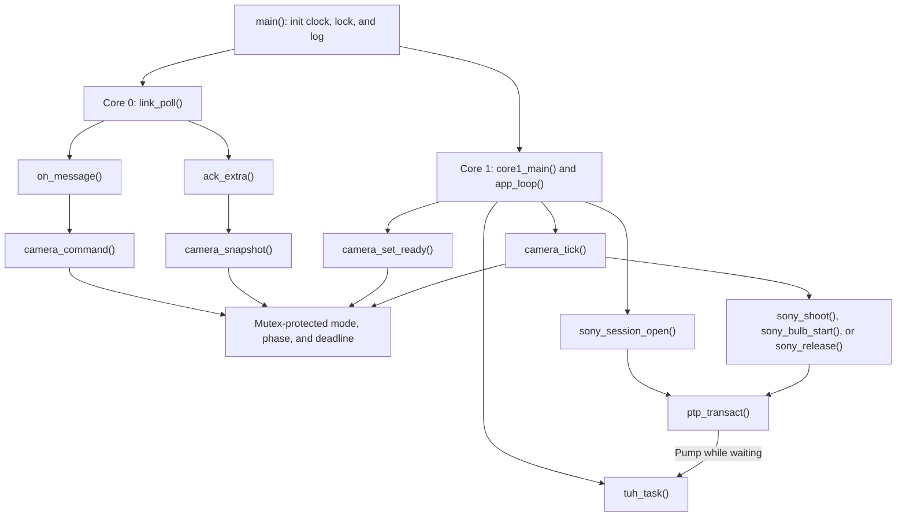
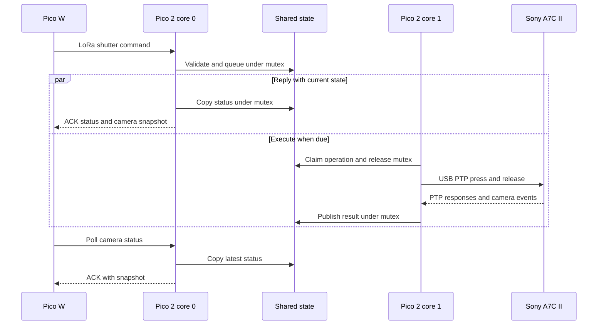

# Pico 2 camera firmware

[Project README](../README.md) · [Pico W firmware](pico-w.md) · [LoRa protocol](lora-protocol.md)

Core 0 receives LoRa commands and services the native USB CDC console. Core 1 owns the PIO USB host and Sony PTP session. A Pico SDK mutex protects the operation slot in [camera_control.c](../camera_pico2/camera_control.c). USB transfers run outside that lock, allowing the radio to reply during a shot.

## Cross-core call graph

## Command and result sequence

The two branches can interleave. Core 1 may begin a shot before the RF ACK leaves the Pico 2. The ACK contains the acceptance code and the state that exists when `ack_extra()` runs.

## Boot, USB readiness, and diagnostics

[main.c](../camera_pico2/main.c) sets the clock to 120 MHz for PIO USB timing, initializes the scheduler mutex and log queue, then launches core 1. [tusb_config.h](../camera_pico2/tusb_config.h) assigns native USB root port 0 to CDC and PIO USB root port 1 to the camera host. `core1_main()` configures GP0 for D+ with D− on GP1 and calls `tuh_init()`.

On attachment, `app_loop()` arms camera events, waits 800 ms, and tries the Sony session handshake. When no device is mounted, the host pulses bus reset every 8 s by default. A failed open is followed by a close attempt and a retry after 2 s. A failed shutter operation drops readiness, closes the session, and starts recovery after 1 s. Failed operations and uncertain bulb release can require a cleanup release after the session reopens.

Core 0 services `tud_task()`, `link_poll()`, and the LED. The LED pattern distinguishes an absent device, a mounted device, an available PTP interface, and an open session. It flashes faster during shutter operations and bulb hold. [applog.c](../camera_pico2/applog.c) shares a bounded queue between the cores and drops old entries when full. Core 0 drains the queue to the CDC endpoint. [status.h](../camera_pico2/status.h) supplies lightweight diagnostic fields for the LED and heartbeat.

## Scheduling and synchronization

| Function | Caller | Role |
| --- | --- | --- |
| `camera_command()` | Core 0 through `on_message()` | Validates the action, duration, readiness, and slot occupancy. |
| `camera_snapshot()` | Core 0 and core 1 recovery | Copies status under the mutex and computes remaining time in timed phases. |
| `camera_set_ready()` | Core 1 | Publishes readiness. Losing the interface ends an active run. |
| `camera_tick()` | Core 1 with an open session | Claims due work under the mutex, performs PTP work after unlocking, then publishes the result under the mutex. |

- Immediate and interval commands are due at acceptance. Delayed mode sets its deadline to acceptance time plus the requested duration. The scheduler uses milliseconds since boot and signed deadline differences, allowing normal clock wraparound.
- After an interval shot, the next deadline is the previous start plus the period, clamped to finish time when a shot overruns. There is no backlog. Stop clears queued or waiting work. During a shot it sets `CAM_STOPPING`, letting the current sequence finish without scheduling another. Stop with no interval active is a no-op success.
- Bulb enters `CAM_EXPOSING` once the start transaction succeeds. The deadline is the transaction completion time plus the requested hold. The host loop continues pumping events during the hold and calls `sony_release()` once due. The firmware countdown does not measure sensor exposure directly.
- A new run resets its counters. `shots` counts completed attempts, including failures. `image_events` is the delta of the running object-event counter during the latest attempt. A successful press/release can finish before an image event arrives.
- On bulb USB failure, the scheduler retries release or cleans up the failed start when TinyUSB still reports the interface as ready. A failed release or disconnect during a hold gives an unconfirmed release result. Recovery attempts release after reopening the session. A lost LoRa link does not change camera deadlines.

## TinyUSB and PTP transport

[ptp_host.c](../camera_pico2/ptp_host.c) registers an application host class driver through `usbh_app_driver_get_cb()`. `ptp_open()` claims a Still Image class `0x06`, subclass 1 interface and opens its endpoints. `ptp_set_config()` gives transport readiness once both bulk endpoints exist. The browser's camera-ready flag also requires a successful Sony handshake.

| Endpoint | Transfer |
| --- | --- |
| Bulk OUT | PTP command and optional data-out container. |
| Bulk IN | Data-in containers and the final response. |
| Interrupt endpoint, if present | Asynchronous camera events such as Sony ObjectAdded `0xC201`. |

`ptp_transact()` uses the little-endian helpers in [ptp.h](../camera_pico2/ptp.h). The 12-byte header contains total length, type, operation or response code, and transaction ID. `OpenSession` uses ID 0. Later transactions increment the counter. The bulk wrappers claim and submit the endpoint, then `wait_xfer()` pumps `tuh_task()` until the bulk callback signals completion or the timeout expires. The separate interrupt callback counts events and rearms its endpoint on success. The class close callback clears transport readiness and unblocks a pending wait.

`read_container()` streams through a 512-byte buffer, skips leading zero-length packets, and discards payload beyond the caller's capacity. The Sony layer drains property data without retaining the full roughly 10 KB list. Transactions run serially on core 1. The incoming parser uses container type and code and does not verify the response transaction ID.

## Sony PC Remote operations

[sony_ptp.c](../camera_pico2/sony_ptp.c) implements the capture-derived session and shutter sequence. The `op()` helper checks PTP success `0x2001` and maps transport failure to `0xFFFF`. Usual operations pass a 3,000 ms timeout per bulk wait. Session close passes 1,000 ms.

| Order | Operation | Details |
| --- | --- | --- |
| 1 | `OpenSession` (`0x1002`) | Session ID 1, transaction ID 0. An already-open response is tolerated. |
| 2 | `GetDeviceInfo` (`0x1001`) | Device information phase. |
| 3 | `SDIO_Connect` (`0x9201`) | Calls with `(1,0,0)` then `(2,0,0)`. |
| 4 | `SDIO_GetExtDeviceInfo` (`0x9202`) | `(0x012C,1)`, with `0x00C8` as the fallback version. |
| 5 | `SDIO_Connect` (`0x9201`) | Final call with `(3,0,0)`. |
| 6 | `SetControlDeviceA` (`0x9205`) | Property `0xD25A` with one-byte value `1`. |
| 7 | `GetStorageIDs` (`0x1004`) | Best effort. The reference capture returned `0x2013`. |

A normal shot writes 16-bit values using `SetControlDeviceB` (`0x9207`). `sony_shoot()` sends S1 down (`0xD2C1 = 2`), S2 down (`0xD2C2 = 2`), and polls `GetAllExtDevicePropInfo` (`0x9209`) for approximately 1 s. Each individual property query can extend beyond the hold threshold. `sony_release()` attempts S2 up (`0xD2C2 = 1`) and S1 up (`0xD2C1 = 1`) even if an earlier step fails.

For bulb, `sony_bulb_start()` sends S1 up and `RequestOneShooting` (`0xD2C7 = 2`). At expiry the same release helper sends S2 up and S1 up. Manually configure the camera for BULB with its own BULB Timer disabled. [libgphoto2 Sony bulb implementation](https://github.com/gphoto/libgphoto2/blob/662abd148dfd6ecbbacb3ddaa9134d4b357f15e1/camlibs/ptp2/config.c#L10622)

## Porting to another camera

Start at the camera-facing layers. Verify which USB interface the camera exposes in its remote mode, then compare its session setup, control commands, and events with the Sony sequence. Map the new backend to the scheduler's open, close, shoot, bulb start, and release operations. Keep event counting tied to the new model's actual image event. The LoRa packet format only needs to change if the new backend exposes extra actions or status fields.
