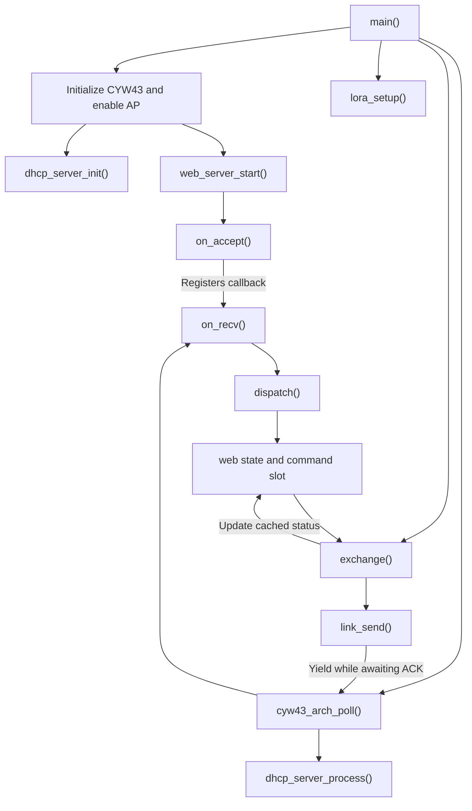

# Pico W firmware

[Project README](../README.md) · [Pico 2 firmware](pico-2.md) · [LoRa protocol](lora-protocol.md)

The Pico W bridges HTTP and LoRa. It holds one pending command and the most recent camera snapshot in `web_state_t`. Both the main loop and TCP callbacks access that state in a single polling context.

## Call graph

## Startup and scheduling

1. [main.c](../remote_pico_w/main.c) initializes USB stdio and CYW43. Wi-Fi initialization failure exits. If `lora_setup()` fails, the AP and HTTP server can still display the radio diagnostic.
2. `cyw43_arch_enable_ap_mode()` selects open or WPA2 mode from [app_config.h](../remote_pico_w/app_config.h). [dhcpserver.c](../remote_pico_w/dhcpserver.c) binds a UDP listener to the AP interface, parses DHCP options, and tracks leases on the local `192.168.4.1/24` network. The [lease table](../remote_pico_w/dhcpserver.h) has eight entries starting at host address 16.
3. The loop calls `cyw43_arch_poll()`, prioritizes a queued command over a radio status query, then sleeps 500 µs. It computes the next radio query deadline from the end of the exchange.
4. Minimum radio query spacing is 1,000 ms. If needed, the code raises it to `ceil(ACK_airtime_us / (5 × duty_percent))` milliseconds. This targets at most half the configured duty percentage for periodic ACK airtime. The cache freshness limit is three configured poll intervals plus 1,000 ms.

## HTTP transport and API

[web_server.c](../remote_pico_w/web_server.c) uses lwIP raw TCP callbacks under `pico_cyw43_arch_lwip_poll`. [lwipopts.h](../remote_pico_w/lwipopts.h) sets `NO_SYS=1` and configures TCP and heap buffers.

- `web_server_start()` binds TCP port 80. `on_accept()` allocates a connection buffer and registers receive, timeout, and error callbacks.
- `on_recv()` acknowledges and frees the pbuf, accumulates the first line across deliveries, and dispatches the method and target before the HTTP version. A 192-byte buffer bounds the request line. Command arguments are in the URL and the server does not parse request bodies.
- `respond()` sets content type, length, and `Cache-Control: no-store`, queues copies of the data with `TCP_WRITE_FLAG_COPY`, then closes the connection. Allocation and TCP failures can abort a connection.

| Method and target | Operation |
| --- | --- |
| `GET /` | Serve HTML, CSS, and JS from `camera_page.h`. |
| `GET /api/status` | Read the local camera snapshot. |
| `POST /api/command?action=1&seconds=0` | Fire one shot. |
| `POST /api/command?action=2&seconds=5` | Start a five-second interval. |
| `POST /api/command?action=3&seconds=5` | Take one shot after five seconds. |
| `POST /api/command?action=4&seconds=10` | Start a ten-second bulb exposure. |
| `POST /api/command?action=5&seconds=0` | Stop an interval. |

The parser expects unsigned decimal numbers in the displayed order. `camera_command_valid()` checks the action and duration. A successful request sets `web.action`, `web.seconds`, and `web.pending` and returns `202 Accepted`. Invalid inputs return 400, an occupied slot returns 409, and missing or stale camera readiness returns 503. The stop request bypasses the check for fresh camera readiness.

## Command slot and status cache

`exchange(true)` sends the three-byte command as `MSG_SHUTTER`. While awaiting the ACK, `link_send()` calls `cyw43_arch_poll()` through a yield hook. HTTP callbacks can therefore run before `exchange()` returns. The slot remains occupied to prevent a second POST from replacing the in-flight command. HTTP callbacks never send radio frames directly.

`exchange(false)` sends the empty `MSG_CAMERA_STATUS` request. A command received while this query is in flight is sent on the next main-loop pass. A valid ACK contains an 18-byte snapshot. `exchange()` decodes it, records local receipt time, and updates command feedback when appropriate. If command delivery is uncertain, it clears freshness and lets later status queries reconcile what happened.

| Status JSON | Source |
| --- | --- |
| `fresh`, `pending`, `feedback` | Local receipt age, slot occupancy, and radio command feedback. |
| `ready`, `mode`, `phase`, `result` | Camera session and scheduler snapshot. |
| `remaining` | Remaining milliseconds reduced by elapsed time on the Pico W and clamped to zero. |
| `shots`, `images`, `rc` | Completed attempts, object events seen during the latest attempt, and PTP response code. |

## Browser behavior

[camera_page.h](../remote_pico_w/camera_page.h) embeds the page as a C string. `refresh()` reads the local status endpoint and schedules the next read 350 ms after it finishes. Requests have a 2.5 s timeout. `render()` runs every 100 ms and uses `performance.now()` to advance the displayed countdown between responses. Every browser poll reads the same Pico W cache regardless of the number of connected browsers.

`send()` validates timed inputs, submits the POST, and disables duplicate clicks while awaiting the HTTP response. The controls track link freshness, camera readiness, and phase. The interval button changes to **Stop interval** while a run is active. For other actions the Pico 2 is the final authority on whether it is busy.
